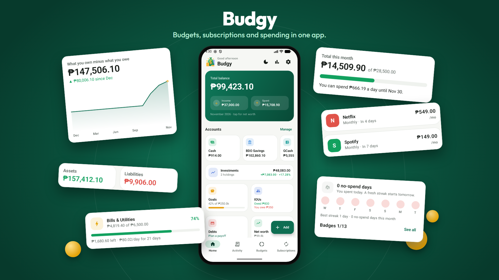
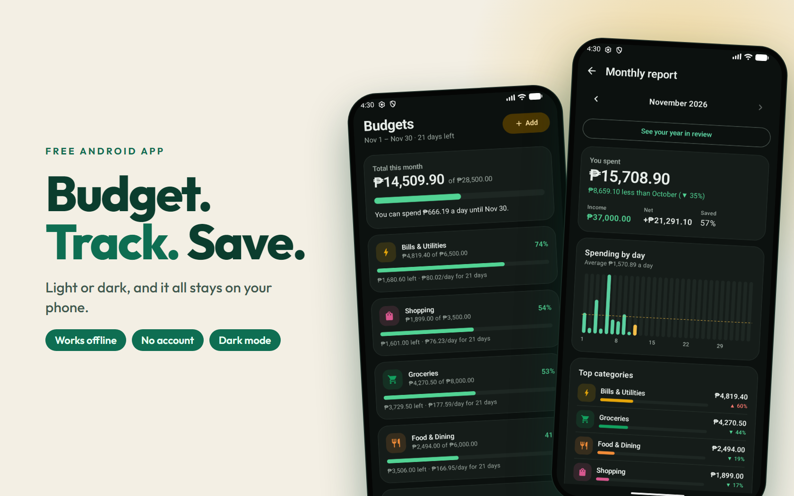

# Budgy

**Personal finance, budget and subscription tracker for Android.**

## About

Budgy helps you see where your money goes. Track your accounts, set budgets, keep an eye on subscriptions, and save toward goals.

Everything is stored on your phone. There is no account and no sign-up, and Budgy works without internet.

## Features

**Everyday money**
- **Accounts:** cash, bank, e-wallet and credit card, with live balances. Transfers never count as spending.
- **Fast entry:** a number pad and category chips, and Budgy remembers your last account and category
- **Categories:** 12 for expenses and 5 for income to start with, and you can add, rename, recolor and change the icon
- **Tags** for trips and events, with totals for each
- **Recurring transactions** that log themselves, or ask you first
- **Activity:** a list and a calendar, with search and filters for account and category

**Budgets and subscriptions**
- **Monthly budgets** per category, with progress and a "per day" allowance
- Budget periods that start on payday, or twice a month, and optional **envelopes** where unspent money rolls over
- **Subscriptions:** weekly, monthly, yearly or custom cycles, free-trial tracking, shared plans, price history and monthly and yearly totals. **Mark as paid** logs the expense for you.
- **Alerts and reminders** for upcoming bills, for budgets at 80% and 100%, and a weekly summary

**Saving and owing**
- **Goals** with a weekly amount to reach your target date
- **Split bills and IOUs:** who owes who, without changing your spending
- **Debt payoff planner:** snowball or avalanche, with your debt-free date
- **Investments:** crypto, Pag-IBIG MP2 and funds or ETFs, with gain and loss. Live crypto prices are optional.
- **Net worth** over the last 12 months

**Insights**
- A home dashboard with your balance, income, spending and a spending donut
- **Monthly report** with the change from last month, spending by day and top categories
- No-spend day streaks, badges and a year in review
- Alerts such as "Food is 40% higher than usual"

**Make it yours**
- Light and dark mode, and a currency picker, plus accounts in other currencies with your own exchange rates
- **English, Filipino and Cebuano**
- A home screen widget and shortcuts: press and hold the app icon to add an expense, income or transfer
- **App lock** with fingerprint, face or screen lock
- **Backup and restore** to a file, **CSV export**, and **CSV import** for Budgy files and most bank or e-wallet statements
- A built-in guide in Settings

## Privacy

Your data never leaves your phone. The only time Budgy goes online is for live crypto prices from CoinGecko, and only after you read the notice in Investments and choose live prices. Settings has an Internet page that explains it and turns it off.

## Getting started

1. Download the latest APK from the [Releases page](https://github.com/direkjames/Budgy/releases/latest) on your phone.
2. Open the file. The first time, Android asks you to allow installs from the app you opened it with.
3. Open Budgy and press **Add** to log your first expense.
4. Set a budget in **Budgets**, and add your subscriptions in **Subscriptions**.

## Requirements

- An Android phone with Android 8.0 or newer

## Built with

- Kotlin and Jetpack Compose
- Room for the on-phone database
- WorkManager for reminders

Want to build it yourself? See [Developing Budgy](docs/DEVELOPING.md). The version history is in the [changelog](docs/CHANGELOG.md).

## Status

Shipped.

## Credits / License

Made by [direkjames](https://github.com/direkjames). See [LICENSE](LICENSE).
